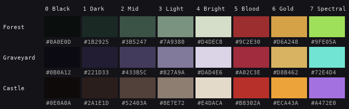

# Stick RPG — Art Style Guide

How to create sprites and backgrounds that drop straight into the game. Read this before drawing anything for Stick RPG.

Reference look: [`mockups/combate_biomas.png`](mockups/combate_biomas.png) and the existing files in `assets/sprites/`.

---

## 1. Art direction

- **Dark medieval fantasy.** A sinister forest of dead trees under a pale moon, a misty graveyard and a ruined castle hall.
- **Side view.** Characters are seen from the side, standing on a flat ground line.
- **Readable at 240 × 135.** The screen is tiny, so use clear silhouettes, big shapes and strong value contrast against a dark background.
- **Clean pixel clusters.** No anti-aliasing, no single stray pixels, no noisy texture. Use dithering only for gradients (sky, mist, glows).

## 2. Palette

The game shows **8 colours at a time**. Each colour index has a fixed **role**, and each biome only changes the hue. Draw once with the indices below and the game re-tints your art for every biome.

| Index | Role         | Typical use                                         |
|-------|--------------|-----------------------------------------------------|
| 0     | **Black**    | Outlines, deepest shadows, near silhouettes         |
| 1     | **Dark**     | Sky, shadow tone, inner contours                    |
| 2     | **Mid**      | Mist, chainmail, shadow of light materials          |
| 3     | **Light**    | Steel, stone, bone base tone                        |
| 4     | **Bright**   | Highlights, moon, eyes and text                     |
| 5     | **Blood**    | Red cloth (cape, plume, banners), blood             |
| 6     | **Gold**     | Gold trims, crowns, torches, buckles                |
| 7     | **Spectral** | Magic glow: eyes, runes, ghost fire (biome accent)  |
| 8–14  | —            | **Never use**                                       |
| 15    | Transparent  | Empty pixels (transparency key)                     |

The exact colours are in the GDD (§8.2) and in the palette files:

| Biome     | Aseprite / GIMP        | Hex list                |
|-----------|------------------------|-------------------------|
| Forest    | `palettes/forest.gpl`    | `palettes/forest.hex`    |
| Graveyard | `palettes/graveyard.gpl` | `palettes/graveyard.hex` |
| Castle    | `palettes/castle.gpl`    | `palettes/castle.hex`    |

The files have 16 entries in index order: 0–7 are the real colours, 8–14 are grey placeholders and 15 is magenta, the transparency key. **Draw with the Forest palette.** The other two are only for previewing how your art looks in each biome.

### Rules

- **Index order matters**, not the exact RGB value. A pixel on index 3 will be steel in the forest and lilac stone in the graveyard.
- Gold (6) and Spectral (7) are also UI signals (criticals, rarity, selection), so use them sparingly as accents.
- Blood (5) is the hero’s identity colour (cape and plume). Enemies may use it in small amounts: scarves, eyes, robes.

## 3. Shading and lines

- **Outline:** a 1 px **Black (0)** outline around the whole silhouette, outside the shape.
- **Inner contours:** where two parts overlap (arm over torso, shield over chest), separate them with a 1 px line of **Dark (1)**.
- **Light comes from the top-left.** Each material uses a 3-tone ramp:
  - top and left edge, 1 px wide: light tone
  - body: base tone
  - bottom and right edge, about 2 px wide: shadow tone

| Material                  | Shadow | Base | Light |
|---------------------------|--------|------|-------|
| Steel / armour (gear)     | 2      | 3    | 4     |
| Stone, rough skin, fur    | 1      | 2    | 3     |
| Bone, ghosts              | 2      | 3    | 4     |
| Leather, dark cloth       | 0      | 1    | 2     |
| Black armour (edge light) | 0      | 1    | 3     |
| Red cloth                 | 1      | 5    | 5     |

- **Glow:** magical things (ghosts, fire) may have a 1 px **Spectral (7)** outline inside the black one.
- **Dithering:** use a regular 4×4 Bayer pattern only, never random noise.

## 4. Hero (the knight)

| Property     | Value                                                              |
|--------------|--------------------------------------------------------------------|
| File         | `assets/sprites/heroe.aseprite`                                    |
| Canvas       | **70 × 90 px**                                                     |
| Facing       | **Right**                                                          |
| Anchor       | Feet at **(26, 89)**: the bottom row, x = 26                       |
| Mode         | Indexed, Forest palette, transparent index **15**                  |

### Layers

Use these exact names, listed bottom to top. The game hides a gear layer when that slot is empty and re-tints it by rarity.

| Layer     | Contents                     | Re-tinted by          |
|-----------|------------------------------|-----------------------|
| `cuerpo`  | Cape, chainmail, legs        | — (never)             |
| `botas`   | Greaves and sabatons         | Boots rarity          |
| `pechera` | Breastplate, pauldron, belt  | Chestplate rarity     |
| `casco`   | Helmet and plume             | Helmet rarity         |
| `escudo`  | Shield                       | Shield rarity         |
| `brazo`   | Sword arm and sword          | Sword rarity          |

**Gear recolour rule:** on gear layers, the game swaps **index 3 (Light)** for Spectral (Rare) or Gold (Epic). Paint the main armour surfaces in 3, and use 2 and 4 for shadow and highlight. Anything that must not change colour (plume, gold trims, leather) has to avoid index 3.

### Animations

Every frame contains every layer. Tags and frame durations:

| Tag      | Frames | Duration      | Notes                                                    |
|----------|--------|---------------|----------------------------------------------------------|
| `idle`   | 2      | 700 ms each   | Breathing: frame 2 lowers torso, head and arms by 1 px   |
| `attack` | 3      | 90 ms each    | Wind-up, slash (the hit lands here), follow-through      |
| `charge` | 1      | —             | Sword raised high while charging the special             |
| `hit`    | 1      | —             | Recoil; the game also flashes it white                   |

The hero never walks.

## 5. Enemies and bosses

| Property     | Value                                                                    |
|--------------|--------------------------------------------------------------------------|
| Files        | `assets/sprites/<name>.aseprite`, one per enemy                          |
| Facing       | **Left**, towards the hero                                               |
| Layers       | A single layer named `cuerpo`                                            |
| Canvas width | **Must be even**                                                         |
| Feet         | On the **bottom row** of the canvas                                      |
| Size         | Regular enemies ~60–90 px tall; bosses ~90–108 px tall, up to ~124 px wide |

### Frames and tags

Use exactly 8 frames, in this order:

| Tag       | Frames | Duration     | Notes                                                    |
|-----------|--------|--------------|----------------------------------------------------------|
| `walk`    | 0–1    | 180 ms each  | Walking in from the right                                |
| `idle`    | 2–3    | 650 ms each  | Breathing (ghosts float up and down)                     |
| `attack`  | 4–5    | 120 ms each  | Wind-up, strike                                          |
| `hit`     | 6      | —            | Recoil (the game flashes it white and dissolves it on death) |
| `prepare` | 7      | —            | Charging a heavy blow; a red “!” is drawn above it       |

### Current enemies

The anchor is the feet position inside the canvas, in the left-facing file. Keep the same size and anchor when you redraw one, or tell me the new values.

| Name (file)       | Canvas    | Anchor (x, y) | Type    |
|-------------------|-----------|---------------|---------|
| `salteador`       | 100 × 72  | (56, 71)      | Regular |
| `golem`           | 138 × 78  | (68, 77)      | Regular |
| `huargo`          | 132 × 65  | (66, 64)      | Regular |
| `troll`           | 164 × 92  | (95, 91)      | Regular |
| `rey_ciervo`      | 196 × 108 | (106, 107)    | Boss    |
| `dama_espectral`  | 204 × 102 | (118, 101)    | Boss    |
| `caballero_negro` | 200 × 101 | (119, 100)    | Boss    |
| `tejedora`        | 202 × 92  | (114, 91)     | Boss    |
| `rey_liche`       | 174 × 108 | (91, 107)     | Boss    |

### AI-generated strips

The current enemies come from the strips in `assets/ai/` (8 frames in a row, facing left, magenta background). `python3 tools/art/build.py --enemies` imports them with `tools/art/import_ai.py`: it splits the frames, maps every pixel to the 8 palette roles, scales to the height set in `SOURCES`, aligns the frames by the torso, closes the black outline and recomputes canvas and anchor. To replace an enemy, drop a new strip there with the same name and run that command, then `make sprites`.

The hero comes from `assets/ai/heroe.png` (7 frames facing right) and `assets/ai/heroe_mapa.png` (same silhouette, one flat colour per layer: helmet blue, chestplate yellow, boots cyan, shield orange, sword arm green, body grey). `python3 tools/art/build.py --hero` splits it into the six layers and fills the torso behind the shield so the hero looks right without one.

### Screen placement

- The enemy’s feet stand at screen point **(186, 113)**.
- The hero’s feet stand at **(50, 113)**.
- The HUD covers **y ≥ 112**.
- While the special charges, a full-width bar covers **y ≤ 19**. Keep boss faces below that line where possible.

## 6. Backgrounds

| Property  | Value                                                                 |
|-----------|-----------------------------------------------------------------------|
| Files     | `assets/sprites/bg_<biome>.aseprite` (`bg_bosque`, `bg_cementerio`, `bg_castillo`) |
| Canvas    | **240 × 135 px**, 1 frame                                             |
| Tiling    | **Every layer must tile horizontally**: the left and right edges join seamlessly |
| Ground    | Feet stand on **y = 112**; ground runs from y ≈ 110 to the bottom     |

### Layers

Use these exact names, listed back to front:

| Layer    | Contents                                       | Parallax shift per encounter |
|----------|------------------------------------------------|------------------------------|
| `cielo`  | Sky; **fully opaque** (no transparent pixels)  | none (fixed)                 |
| `lejos`  | Far silhouettes (pines, hills, church)         | small                        |
| `niebla` | Static mist band (dithered, sparse)            | small                        |
| `medio`  | Trees, fences, columns, banners                | medium                       |
| `suelo`  | Ground strip                                   | large                        |
| `frente` | Foreground at the edges (ferns, rubble), drawn **in front of** characters | largest |

The characters are drawn between `suelo` and `frente`.

### AI-generated backgrounds

`assets/ai/bg_<biome>.png` holds one portrait image per biome with the five layers stacked as horizontal bands (sky, far, middle, ground, foreground; magenta behind the cut-out ones). `python3 tools/art/build.py --bg` splits the bands, scales them to 240 px wide, places each layer at its row (`BG_PLACE` in `tools/art/import_ai.py`) and keeps the procedural mist. Run `make sprites` afterwards.

### Background tips

- The game draws **procedural clouds** over the sky in outdoor biomes. Leave the upper sky (y ≈ 4–56) fairly clean; a moon or stars are fine.
- Keep the area behind the characters (x 20–80 and x 140–230, y 40–112) low in contrast so they stand out.
- The bottom strip (y ≥ 112) sits under the HUD, so keep it simple.
- Indoor biomes (castle): the `cielo` layer is the back wall, and there are no clouds.

## 7. Title logo

`assets/sprites/titulo.aseprite` holds the logo: a single layer, **208 × 72 px**. It is imported from `assets/ai/titulo_logo.png` (magenta background). The title background is `assets/sprites/titulo_fondo.aseprite` (**240 × 135**, opaque), imported from `assets/ai/titulo_fondo.png` with ordered dithering. Rebuild both with `python3 tools/art/build.py --title` and `make sprites`. The game animates it with a drop-in, a glint and sparkles. The glint only passes over non-black pixels.

## 8. How to deliver art

### Option A — Aseprite file (preferred)

1. Create the file in **Indexed** mode. Load `docs/palettes/forest.gpl` and set the **transparent colour to index 15**.
2. Use the exact canvas size, layer names, frame count and tags listed above.
3. Save it as `assets/sprites/<name>.aseprite`, keeping the existing name to replace a sprite.
4. Run `make sprites` and then `pio run -t upload`. Or just send me the file and I will integrate it.

**Never run `make art` after editing by hand.** It regenerates every sprite from the scripts and overwrites your `.aseprite` files.

### Option B — PNG files

Send one PNG per frame. For the hero, send one PNG per frame and per layer. Requirements:

- Use only the exact Forest palette colours.
- Mark transparency with **magenta `#FF00FF`** or real alpha.
- Name the files `<name>_<tag>_<frame>.png`, plus `_<layer>` for the hero. For example: `huargo_walk_0.png`, `heroe_attack_1_brazo.png`.
- Include a note with the canvas size and the feet anchor.

I will convert them into `.aseprite` files and hook them up.

### New enemies or biomes

Replacing art needs no code changes. **Adding** a new enemy, boss or biome does, because the game logic and tables have to know about it. Send the art and I will wire it in.

### Checklist

- [ ] Indexed mode, Forest palette, transparent index 15
- [ ] Only indices 0–7 used, plus 15 for transparency
- [ ] 1 px black outline; light from the top-left; 3-tone ramps
- [ ] Correct canvas size (even width), feet on the bottom row, correct facing
- [ ] Exact layer names and tags; correct frame count
- [ ] Backgrounds tile horizontally; `cielo` fully opaque
- [ ] Checked in all three palettes (forest, graveyard, castle)

## 9. UI quick reference

These are not needed for sprites, but they help to match the look of the UI.

- **Panels:** Black fill, Light top edge, Mid left edge, Dark bottom and right edges, Gold rivets in the corners.
- **Selection:** double Gold frame with pulsing Bright corners; unselected panels are dimmed with a Black dither.
- **Fonts:** FreeSerif 9, 12 and 18 pt (bold and italic) for titles and screens; a custom 5×7 pixel font (`tools/art/font.py`) in bold for the HUD and lists.
- **Signal colours:**
  - Blood: HP and damage
  - Gold: criticals, perfect timing, selection, Epic items
  - Spectral: magic, runes, healing, Rare items
  - Light: Common items
